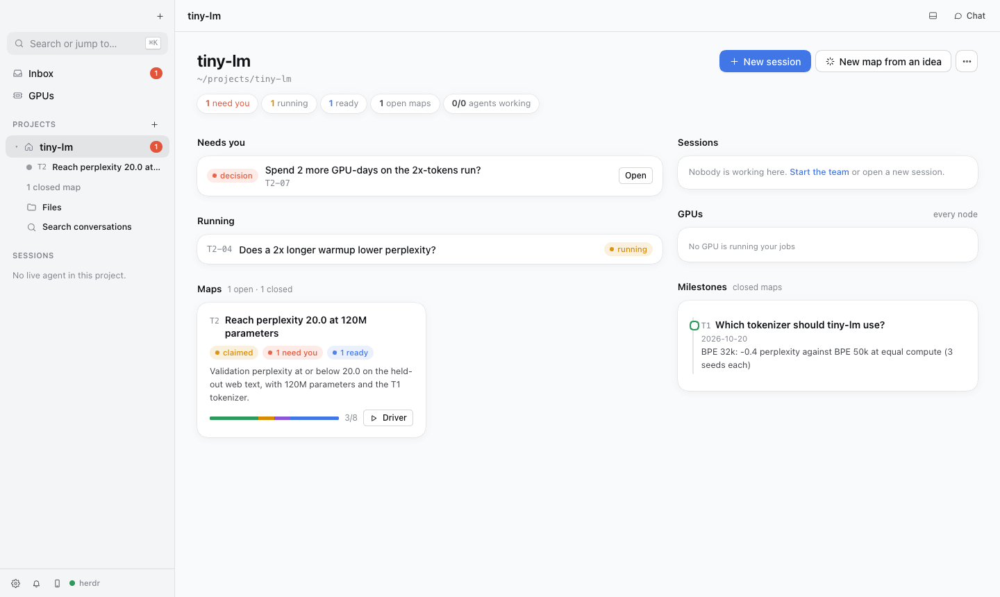
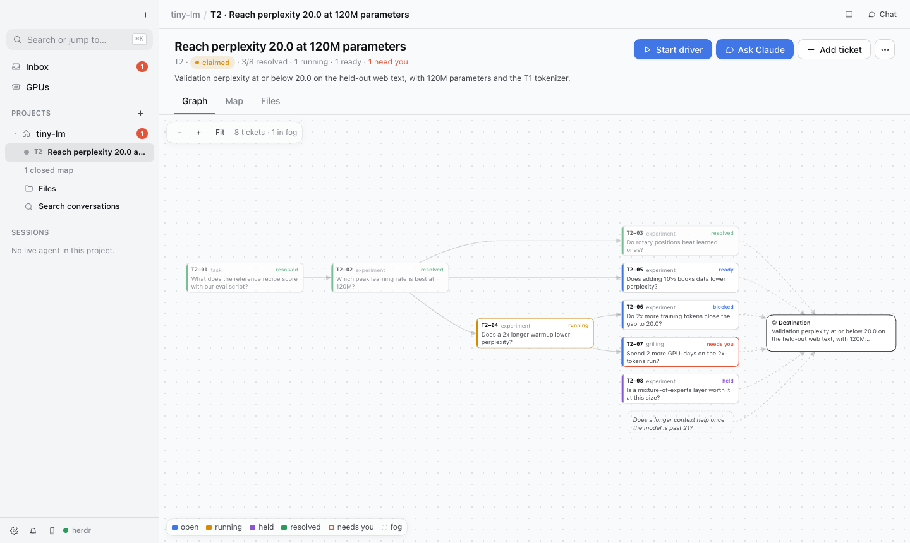
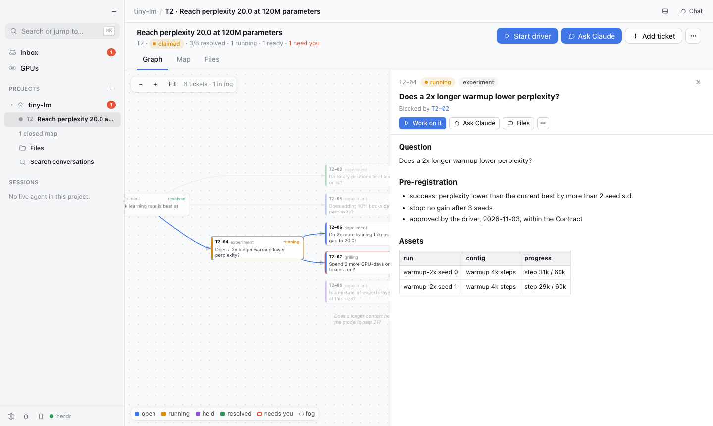
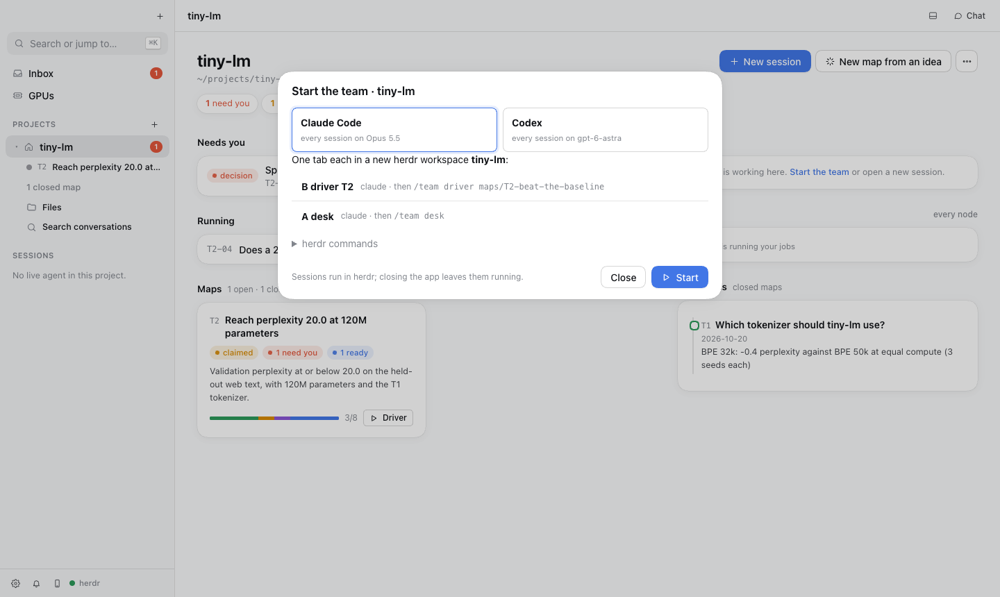

# sliu-skill

Agent skills for running research projects with coding agents: Claude Code first, Codex supported. You give a project a
destination ("beat baseline X on benchmark Y"); the agent keeps a map of the questions between here and there, works them
one ticket at a time with pre-registered criteria, reviews every answer before it counts, and asks you only for the
decisions that are yours.

Built on [Matt Pocock's skills](https://github.com/mattpocock/skills): where a skill has a counterpart in his repo, its
wording follows his as closely as possible, and every difference in logic is listed under
[Differences from Matt's skills](#differences-from-matts-skills).

**Contents:** [What it looks like](#what-it-looks-like) · [Quick start](#quick-start) · [Two ways to use it](#two-ways-to-use-it) · [How it works](#how-it-works) ·
[Commands](#commands) ·
[Using Codex](#using-codex) · [Team mode with herdr](#team-mode-with-herdr-optional) ·
[Research Desk app](#research-desk-app-optional-macos) · [Make it yours](#make-it-yours) · [Skills](#skills) ·
[Differences from Matt's skills](#differences-from-matts-skills) · [Layout](#layout) · [Credits](#credits) ·
[License](#license)

## What it looks like

A made-up demo project, `tiny-lm`, in the Research Desk app (optional; everything also works from a terminal).



**The project page.** What needs you first (here, a decision only you can make), what is running, each open map with its
progress, and the milestones: closed maps with their one-line outcomes.



**A map, drawn as a graph.** Each box is a ticket (one question), each arrow a blocking edge, each colour a state
(resolved, running, ready, blocked, needs you, held); the dashed box is fog, a question not yet sharp enough to ticket.
Everything flows to the destination on the right.



**A ticket.** Its question, its pre-registration (fixed before anything ran), and its assets: the runs, with their progress.



**Start the team.** One click opens a desk and a driver per open map in herdr tabs, all Claude Code or all Codex; the
drivers open a worker tab per ticket as they go. You then talk to the desk.

## Quick start

You need Claude Code (or Codex, see [Using Codex](#using-codex)), git and Python 3.10+. Nothing else is required: one
session in one terminal runs the whole loop.

```bash
git clone https://github.com/Steven51516/sliu-skill ~/research-harness
~/research-harness/install.sh
```

`install.sh` links every skill into `~/.claude/skills` (Claude Code) and `~/.agents/skills` (Codex), puts the commands on
your PATH (`research-status`, `codex-run`, `team-up`, `team-worker`, `team-watch`, `trash`,
`research-gui`, and anything in `tools/local/`), and removes links left by skills that were removed or renamed. Nothing is copied: edit a file here and
every project sees it. Safe to rerun.

Then, in Claude Code:

1. **Read `STYLE.md` and make it yours.** It is the author's standing rules for every project: scientific honesty, what
   always needs your OK (GPU-hour thresholds, deleting data, posting externally), code and docs habits. Every session
   reads it.
2. **Set up a project:** in its folder, `/research-init <name>`. It writes `AGENTS.md`, `CLAUDE.md`, the issue tracker doc,
   the delegation doc and a scope file pointer (where the project runs; see [Make it yours](#make-it-yours)).
3. **Chart a map:** `/wayfinder "<a loose idea>"` interviews you and charts it; `/to-map` turns what you already
   discussed into one.
4. **Drive it:** `/loop /research-drive <map>`. Each pass merges finished tickets, dispatches the ready ones to fresh
   subagents, and files the next questions when the frontier runs dry.
5. **Check in:** `research-status --now` prints what is running, what waits on you and what is ready; `STATUS.md` lists
   milestones and open maps.

## Two ways to use it

**With the app and a team (easiest).** You talk to one session, the desk, and the rest runs in herdr tabs you can watch.

1. Set up herdr and the Research Desk app once: [Team mode](#team-mode-with-herdr-optional) and
   [Research Desk](#research-desk-app-optional-macos).
2. In the app, press **New project**: it makes the folder and starts `/research-init`, which sets up the scope, tracker
   and docs by asking you a section at a time. For an existing folder, use **Add project** and run `/research-init` once.
3. Chart a first map: **New session → Chart a new map** runs `/wayfinder` with you.
4. Press **Start team** and pick Claude Code or Codex. The app opens a desk, a driver for each open map, and a watch tab;
   each driver opens a worker tab per ticket and closes it when the ticket is done.
5. Talk to the desk in the app's chat. It reports results, puts each decision to you, and passes your answers to the
   drivers. The app shows what waits on you and can notify your phone.

Without the app, the same team starts from a herdr pane in the project folder: `team-up <map>` (or `--codex`).

**By hand, in one session.** Everything also works in a single Claude Code (or Codex) session, one command at a time:

| Step | Command |
|---|---|
| set up the project | `/research-init <name>` |
| open a new map for a new line of work, from what you just discussed | `/to-map` |
| … or from a loose idea, with an interview | `/wayfinder "<idea>"` |
| add a question to a map | `/to-tickets <map> "<question>"` |
| work one ticket yourself | `/research-work <ticket>` |
| let the session drive the whole map | `/loop /research-drive <map>` |
| see where things stand | `research-status --now` |
| change the plan or the Contract | `/wayfinder <map> --rechart` |

Terms such as map, ticket, frontier and Contract are defined in [GLOSSARY.md](GLOSSARY.md).

## How it works

Research is a search, not a build: each answer changes the next question. So the plan is a map that keeps growing, not a
fixed task list.

```
idea ──wayfinder / to-map──▶ MAP: destination, Contract, decisions so far, fog
                               │
                               ├─to-tickets─▶ TICKETS: one question each, blocking edges, pre-registration
                               │
   research-drive, one pass ───┤  dispatch the frontier ─▶ research-work (a fresh session per ticket)
   (repeat with /loop)         │                              runs jobs, follows rigor, writes the answer
                               │  merge ◀── review (one fresh reviewer: Fair, Spec, Code) ◀──┘
                               │  frontier empty: new tickets from the fog
                               ▼
              destination reached, or measured unreachable ─▶ map closes; its outcome is a milestone
```

**Projects and maps.** A project is the whole research effort, often months long (say, "a protein language model that
folds well"). A map is one line of work inside it with one measurable finish line: "a 2B model with discrete tokens
reaches TM-score 0.7 on our benchmark", or "continuous tokens beat that". A project has several maps over its life, often
a few at once, much as a thesis has chapters and each chapter one claim. A map is what makes a line of work tractable:
- **a finish line:** it closes when its destination is reached, or when a measured answer says it can't be. That outcome
  is a milestone, not an open-ended exploration;
- **comparable results:** its Contract fixes the benchmark, baselines and recipe, so every ticket on it compares like with
  like; changing the benchmark is a deliberate re-chart, never a drift;
- **a bounded scope:** what belongs, what is fog for later, what is out of scope;
- **a stated autonomy:** what the agent may do on this map without asking;
- **parallel lines of work:** one driver per map, so two maps run side by side without mixing their context, claims or
  numbers.

- A **map** charts the way to one **destination**: Decisions so far, the **fog** not yet sharp enough to ticket, and
  what is Out of scope. Its **Contract** names the benchmark every ticket is scored on, the reference recipe, and what
  may be done without asking. Only you change it.
- A **ticket** is one question, sized to one agent session. Its type says how the question gets answered:

  | Type | Answered by | When |
  |---|---|---|
  | `experiment` | the agent, with a run | the decision waits on a number: train, evaluate or analyse against a **pre-registration** (success and stop criteria written and approved before anything runs, never edited after) |
  | `task` | the agent, or you | something must be done or built first (a dataset, access, a tool), with a check that says it is done |
  | `research` | the agent, reading | a fact from papers, docs or code that a decision waits on |
  | `grilling` | you, in conversation | a decision only you can make; the agent interviews you and records the answer |
  | `prototype` | you and the agent | "how should it look or behave": a cheap rough version to react to |

  Runs, arms and smoke tests are **assets** of their ticket, never tickets of their own: a new question gets a new
  ticket, a new run does not.
- **`rigor`** is the rule set for a trustworthy answer (verify the measurement, same benchmark, numbers from files with
  the full denominator, no leakage, every difference recorded). **`review`** checks an answer before it enters the map.
- **The driver does no ticket work**, so its context stays small and any fresh session can take over from the files. It
  may do a small chore itself (a check, a count, a trivial edit); anything with a run or a number is a ticket.
- **What reaches you:** anything on STYLE's always-ask list, a change to a destination or Contract, a decision ticket
  (`grilling`), and a failure. Everything else keeps moving, whether or not you are there; `/ketchup` catches you up.
- **State lives in files** (maps, tickets, `STATUS.md`, `scratch/agents/driver.log`), never only in a chat, so sessions
  can stop, compact or be replaced without losing anything.

## Commands

| You want to… | Run |
|---|---|
| set up a project (scope, issue tracker, delegation) | `/research-init <name>` |
| pick a project back up ("where are we?") | `research-status --now` (live state), `STATUS.md` (milestones, open maps) |
| open a new map from what you already discussed | `/to-map` |
| open a new map from a loose idea (it interviews you) | `/wayfinder "<loose idea>"` |
| add a ticket | `/to-tickets <map> "<question>"` |
| work one ticket | `/research-work <ticket>` |
| **default:** work a map in one session, a fresh subagent per ticket | `/loop /research-drive <map>` |
| re-plan a map | `/wayfinder <map> --rechart` |
| review a ticket's answer yourself | `/review <ticket>` |
| catch up on a long chat and every call waiting on you | `/ketchup` |
| optional: a team in herdr tabs (a desk you talk to, a driver per map, worker tabs) | `team-up <map>` ([Team mode](#team-mode-with-herdr-optional)) |
| optional: everything in one desktop app | `research-gui` ([Research Desk](#research-desk-app-optional-macos)) |

## Using Codex

The skills are plain markdown and work in Codex too: `install.sh` links them into `~/.agents/skills`, and
`/research-init` writes both `AGENTS.md` (Codex reads this) and `CLAUDE.md` (which imports it). What differs:

| In Claude Code | In Codex |
|---|---|
| `/research-drive <map>`, `/team desk` … | ask for a skill by name: "use the research-drive skill on maps/T1-x". Skills marked user-only (`research-init`, `wayfinder`, `to-map`, `team`, `retro`, …) are hidden from Codex's model: point it at the file, "read ~/.agents/skills/team/SKILL.md and follow it as `team desk`" |
| `/loop` repeats a driver's pass on a schedule | no loop: prompt each pass yourself, or run an all-Codex team, where `team-watch` types `tick` into an idle driver every 25 min |
| a fresh subagent per ticket | a Codex worker per ticket in team mode; in a single session, Codex works tickets itself |
| `team-roster-hook`, `delete-guard`, `team-worker --rescue` | Claude-only helpers; Codex asks in plain text and is not hit by Claude's safeguard stops |

**Mixing the two:** a Claude Code session can hand work to Codex with `codex-run` (every call carries the same model,
effort and sandbox, checks its exit code and answer, and strips tokens from the environment); which work goes there is a
per-project rule in `docs/agents/delegation.md` (the author sends biology-heavy coding, analysis and reviews to Codex).
A **team** is all Claude Code or all Codex, never mixed: `team-up --codex <map>`, or pick Codex in the Research Desk's
Start team. The flags every Codex team session starts with are in `tools/codex-team.args` (model, workspace-write sandbox
with network, never ask for approval; medium effort for the desk and driver, xhigh for workers).

## Team mode with herdr (optional)

One session per map is the default and enough for most work. A team helps when several maps run at once and you want
to watch or answer each worker: a **desk** you talk to, a **driver** per map in its own tab, and a **worker** tab per
ticket that the driver opens and closes. They run the same skills; `skills/team/team/TEAM-PROTOCOL.md` has the
roster and the one-line messages between them.

Teams run in [herdr](https://herdr.dev), a terminal workspace manager that can start, read and prompt agents in tabs.
Setup, once:

1. Install herdr, then let it see each agent's state: `herdr integration install claude` (and `codex`).
2. **Claude Code on macOS:** new herdr tabs cannot read Claude Code's login from the Keychain on their own, so store a
   long-lived token where `team-up` and `team-worker` look for it:
   `claude setup-token`, then `security add-generic-password -a "$USER" -s claude-code-oauth -w "<token>"`.
   On Linux, Claude Code reads its own login file and this step is not needed.
3. Open `claude` (or `codex`) once in each project folder and accept its folder-trust prompt, or the first worker stops
   there.
4. Optional, Claude Code: add the roster hook to `~/.claude/settings.json` under `hooks.SessionStart`, so a team session
   that restarts under a new name updates the roster:
   `{"type": "command", "command": "python3 ~/research-harness/tools/team-roster-hook.py", "timeout": 10}`.
   Recommended for unattended sessions: the delete guard under `hooks.PreToolUse`, so a recursive delete asks you and,
   unanswered for 15 min, becomes a `trash` move instead of a session stuck at the prompt (`tools/delete-guard.py` says how):
   `{"matcher": "Bash", "hooks": [{"type": "command", "command": "python3 ~/research-harness/tools/delete-guard.py", "timeout": 10}]}`.

5. Optional, to save tokens, in `~/.claude/settings.json`: `"autoCompactWindow": 400000`, so long sessions compact at
   400k tokens instead of near the model's full window (every call re-reads the context); and in its `env` block,
   `"CLAUDE_CODE_SUBAGENT_MODEL": "claude-sonnet-5-5"` (plus `"CLAUDE_CODE_SUBAGENT_MODEL_FORCE": "1"` to apply it to every
   subagent), so subagents run on a cheaper model.

Then, from a herdr pane in the project folder: `team-up <map>` (Claude Code, Opus) or `team-up --codex <map>`. It opens
tabs **A desk**, **B driver** and **watch**; talk to the desk. The watch tab runs `team-watch`: it shows the driver's
log, resumes a Claude driver or worker stopped by a safeguard in its own session (on Sonnet), sends each open question
and each driver gone silent for 90 minutes to your phone once (your own command in
`~/.config/research-harness/notify`), and is a Codex driver's schedule. Keep the machine awake while a team runs (`team-up` wraps the watch in `caffeinate` on macOS).

## Research Desk app (optional, macOS)

A desktop app over the same files and herdr: every project, maps as graphs, tickets, local and server files, chat with
any agent (Claude Code or Codex), terminals, GPUs, and Start team with a click (Claude Code or Codex). Build once:
`cd ~/research-harness/tools/gui/app && npm install && npm run pack`, then `research-gui` opens it. Projects live in
`~/.config/research-gui/projects.toml` (template: `tools/gui/projects.example.toml`). Notifications go to Mac banners,
sounds or a Moshi phone push. `tools/gui/README.md` has the details. It is built for macOS (Keychain logins, banners);
other systems are untested.

## Make it yours

The harness never names a machine, a person or a field; those live in a few files you edit.

| I want to… | Edit |
|---|---|
| change how the agent writes code, commits, reports, or what always needs my OK | `STYLE.md` |
| describe where a project runs (scheduler, storage, GPUs, network) | a scope file that answers `skills/core/research-init/SCOPE-FORMAT.md`, kept with the workspace it describes or in `scopes/` (gitignored) |
| change where one project's maps live (local markdown, GitHub, GitLab) | that project's `docs/agents/issue-tracker.md` |
| change where delegated work and reviews go in one project | that project's `docs/agents/delegation.md` |
| add a rule for one project only | that project's `AGENTS.md`, under "Project notes" |
| add a skill | `skills/<group>/<name>/SKILL.md`, then `./install.sh` |

A mistake that recurs is fixed with a check that fails (a `research-status --check` rule, a `codex-run` guard, an assert
in the project's code) before another sentence: pstack's *Encode Lessons in Structure*. Instructions are for judgment
calls. `FEEDBACK.md` (local, not in git) collects problems found while using the harness, one line each, until a harness
session fixes them. Skill descriptions load when a session starts, so a new skill or a changed `description:` needs a
new session; a changed body applies the next time it is read.

## Skills

Grouped by folder. **core** is the harness: a project needs these. The rest are optional.

**core/**: the research loop

| Skill | Relation to Matt's repo | What it does |
|---|---|---|
| `research-init` | counterpart of `setup-matt-pocock-skills` | set up a project: scope, issue tracker, delegation |
| `wayfinder` | adapted from `wayfinder` | chart a map, work through it, re-chart it |
| `to-map` | adapted from `to-spec` | turn the conversation into a map, without an interview |
| `to-tickets` | adapted from `to-tickets` | question tickets with blocking edges and pre-registrations |
| `research-work` | counterpart of `implement` | work one ticket end to end |
| `research-drive` | counterpart of `implement-spec` | keep a map's frontier moving, a fresh implementer per ticket |
| `rigor` | counterpart of `tdd` | the rules for a trustworthy answer, followed while you work |
| `review` | adapted from `code-review` | review an answer on three axes (Fair, Spec, Code) before it enters the map |
| `grilling` | copied | the interview tickets |
| `run-card` | none in Matt's repo | a one-page reproduction record of a run that affects a milestone (a reference, a result a map relies on, an artifact later work builds on) |

**personal/**: everyday helpers: `wait-what` (adapted: re-pitch the last message), `ketchup` (from pstack: catch up on a long chat and every
call waiting on you), `retro` (adapted: retrospectives), `writing-for-agents` (copied: writing skills and agent docs).

**team/**: `team` (none in Matt's repo): run a project as a desk, a driver per map, and a worker session per ticket
([Team mode](#team-mode-with-herdr-optional)); the only skill that needs herdr and the team tools.

**local/** (gitignored): skills kept on one machine and never pushed.

Helpers on PATH besides the skills: `research-status` generates `STATUS.md`, lists the frontier
(`--frontier`) and checks the maps (`--check`).

## Differences from Matt's skills

Only differences in logic; renamed paths, examples and tracker wiring are not listed.

**Maps execute, under a Contract.** Matt's `wayfinder` plans by default and lets an effort's Notes carry execution into the map. A research map always does, through a section Matt doesn't have, `## Contract`, after his Notes: the **benchmark** (eval set and N, metric, scorer, decoding) and the baselines on it, or `none` when the map measures nothing or hasn't chosen yet; the **reference recipe**; and what may be done **without asking**. Only the user changes it. Matt's Notes keep their meaning (domain, skills to consult, standing preferences). An added ticket type, **`experiment`**, resolves by measurement through `research-work`.

**Pre-registration.** An experiment ticket's success and stop criteria are written and approved before it runs, and never edited after results are seen (amendments are appended and dated). Matt's tickets have no such gate.

**Runs are assets.** Every run, arm, smoke test or variant is a row in its ticket's Assets table; a new run never gets a new ticket, a new question does.

**Re-chart.** `wayfinder` has a third mode, `--rechart`: change the destination or Contract on evidence (the human decides), split a second destination into a new map, rebuild Decisions so far, consolidate closed tickets.

**The local tracker keeps code with tickets.** `maps/<id>-<slug>/map.md`, and one *folder* per ticket (`tickets/NN-<slug>/ticket.md` plus its code and small results), with YAML front matter. `research-status` generates `STATUS.md`, lists the frontier and checks the maps. Matt's local tracker is `.scratch/<effort>/map.md` with one file per ticket. `research-init` proposes GitHub or GitLab when the folder has such a remote, else local markdown (Matt defaults to GitHub).

**Rigor and review, on the result.** `rigor` stands where `tdd` does: rules followed while working (verify the measurement, same benchmark, numbers from files with the full denominator, no leakage, every difference recorded, gains beat the noise), applied by ticket type: all of them for an experiment, the measurement and numbers for a task that builds something later tickets use, none for reading, grilling or other tasks. `review` adapts `code-review`: Matt's Standards and Spec axes become **Fair** (the `rigor` rules) and **Spec** (the pre-registered rule, and no claim beyond the numbers), plus a **Code** axis on the code behind the result, all three by one reviewer with a fresh context (Matt's are parallel sub-agents); it runs once per ticket whose answer later work relies on.

**`research-work` runs jobs, not a red-green loop.** Smoke-test only code never run before; otherwise the real run's first steps are the smoke check; jobs run the way the project's scope file says; failures are classified (execution, measurement, data, method, hypothesis) before anything is called negative. No commits per ticket.

**`research-drive` grows the graph.** Matt's `implement-spec` works a fixed set of tickets to completion and merges branches. Here one call is one pass (repeat with `/loop`): merge finished tickets after their review, dispatch the frontier, and when it runs dry, file the next tickets from the fog inside the map's Contract. What needs the human becomes a `grilling` ticket.

**Milestones and closing maps.** A map closes when its destination is reached or a measured answer says it can't be, as Matt's map issue closes, with a one-line `outcome`. Closed maps' outcomes are the project's milestones: the local tracker's generated `STATUS.md` is a project page of milestones and open maps, regenerated only when a map opens, is re-charted or closes; what is live (waiting on the user, running, the frontier) is printed by `research-status --now`, never stored. Each ticket's and map's `status:` line also says who holds it (`claimed (<session>, <time>)`), as Matt's local `Status:` line does, so a finished ticket can't still look taken; a ticket can be `held` and a map `paused`, both only by the human and both off the frontier. `research-status --check` also catches more than one claim per session, dependency cycles, unknown statuses, prerequisites that are parked or superseded by an unfinished replacement, and resolved tickets without an answer.

**Scope files.** Where a project runs (scheduler, storage, GPUs, network) lives in one scope file the project imports (your own, outside git), so the skills never name a machine.

**Delegation is a project setting, not a role.** The skills only use a few verbs: *delegate* a task, *spin up a subagent* or *a background agent*, *use implementer subagents* (sessions that each work one ticket), *review*, *ask the user*. The project's `docs/agents/delegation.md` says where each goes, the way Matt's issue-tracker doc says where a ticket is published. Delegating is optional: each session does a task itself or delegates it as it judges. The doc only holds the project's rules, each a must for the work it matches: by topic, kind of work or role (e.g. biology-related coding, analysis, paper reading and review go to Codex). Any session may delegate, including an implementer. If the delegate a rule names fails, the session waits or asks; it never hands the work to someone else.

**Team layer, optional and separate.** `team` and `team-up` run the same skills as long-lived sessions: a desk the human talks to, and a driver per active map running `research-drive` under `/loop`, with a roster and short messages (`skills/team/team/TEAM-PROTOCOL.md`). Two verbs resolve to the team: implementer subagents become **workers**, a fresh session per ticket that the driver opens in a tab and closes when the ticket is done, so a worker can open subagents of its own (a subagent cannot) and the human can watch or answer it; and asking the user goes through the desk, which relays the human's words and never decides for them (Matt's HITL rule). The core skills never mention the team, and the team layer only depends on them.

**Per-skill differences**, beyond the vocabulary above:

- `to-map` (vs `to-spec`): it writes a map, not a spec: the benchmark replaces the test seams, the questions you can see coming (Not yet specified) replace the user stories, the decisions already made open Decisions so far, and it ends by calling `to-tickets` for the questions that are already sharp.
- `to-tickets`: tickets are questions, not vertical slices; the fog-or-ticket test and "runs are assets" replace the slicing and wide-refactor rules; the quiz also checks success and stop criteria; an experiment's body carries its pre-registration.
- `research-work` (vs `implement`): no TDD or commits per ticket; jobs, smoke checks, failure classification, `rigor` and `review` as above.
- `to-tickets`, `research-work` and `research-drive` can be called by the model, not only by the user (Matt's counterparts are user-invoked), because a driver files and dispatches tickets itself.
- `research-init` (vs `setup-matt-pocock-skills`): adds the scope and delegation sections and drops triage labels; the domain docs record decisions in `docs/decisions.md`; it keeps both `AGENTS.md` and `CLAUDE.md` (Codex reads only `AGENTS.md`), where Matt edits one of them.
- `retro`: four research categories (orientation, repeated instructions, judgement slips, vocabulary); each fix names where it lands.
- `wait-what`: also defines each project term on first use.
- `research`: not included. A research ticket's subagent reads from primary sources and cites each claim (`wayfinder`
  says so); the skill's "spin up a background agent" and "write a file" are what a subagent cannot do.

**Run cards.** A run that affects a milestone gets a one-page reproduction record (`run-card`).

## Layout

```
skills/      core/ (the research loop, run cards), personal/ (everyday helpers), team/, local/ (gitignored)
STYLE.md     your rules for every project (honesty, what always needs your OK, code, docs)
scopes/      your machine files (gitignored); research-init/SCOPE-FORMAT.md says what a scope answers
templates/   project scaffold research-init writes: AGENTS.md, CLAUDE.md, STATUS.md, docs/decisions.md
             (seeds for docs/agents/ live in skills/core/research-init/)
tools/       status.py (research-status) · codex-run.sh · trash.py · delete-guard.py · local/ (your own, gitignored)
             team-up.sh · team-worker.py · team-watch.py · codex-team.args · team-roster-hook.py (team mode)
             gui/ (research-gui: the Research Desk backend, its web/ page and the app/ shell)
licenses/    licences of copied and adapted third-party skills
install.sh   (re)creates the links; safe to run again
scripts/     check.py: the structural checks CI runs on every push (.github/workflows/check.yml)
AGENTS.md    rules for an agent editing this repo (CLAUDE.md imports it); CONTRIBUTING.md for people
GLOSSARY.md  the terms; CHANGELOG.md the versions
FEEDBACK.md  local only (gitignored): problems found while using the harness, until fixed
```

## Credits

From [mattpocock/skills](https://github.com/mattpocock/skills) (MIT, `licenses/mattpocock-skills-MIT.txt`; synced from commit `a496f55`): copied `research`, `grilling`, `writing-for-agents`, the GitHub and GitLab tracker docs; adapted the domain doc rules (`docs/decisions.md` instead of ADRs); adapted `wayfinder`, `to-tickets`, `to-map` (from `to-spec`), `review` (from `code-review`), `retro`, `wait-what`. Failure classification and the "no viable branch" stop are distilled from [CoAutoResearch](https://github.com/YihongT/CoAutoResearch). Four principles from [pstack](https://github.com/backnotprop/pstack) (MIT, `licenses/pstack-MIT.txt`) are folded in as single lines: *Attack the Premise* (`research-drive`), *Explain the Number* (`rigor`), *Make Operations Idempotent* (`research-work`), *Encode Lessons in Structure* (the CLAUDE.md template and this README); `ketchup` is from pstack; the codex-run preamble follows the prompting rules of [openai/codex-plugin-cc](https://github.com/openai/codex-plugin-cc).

## License

MIT, see [LICENSE](LICENSE). Copied and adapted third-party skills keep their own licences in `licenses/`.
